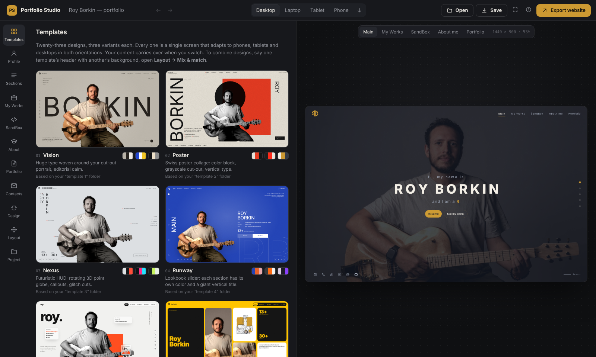
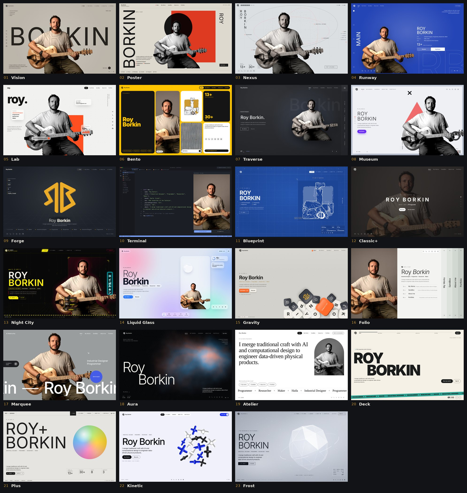
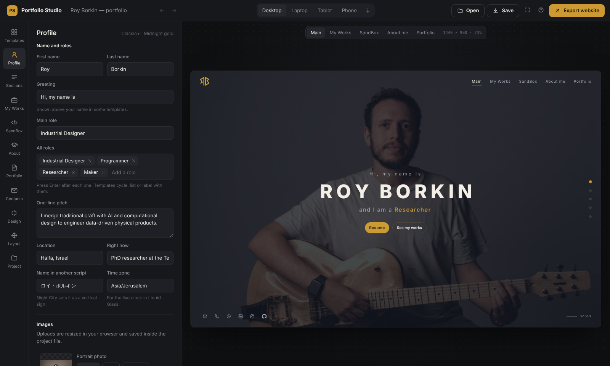
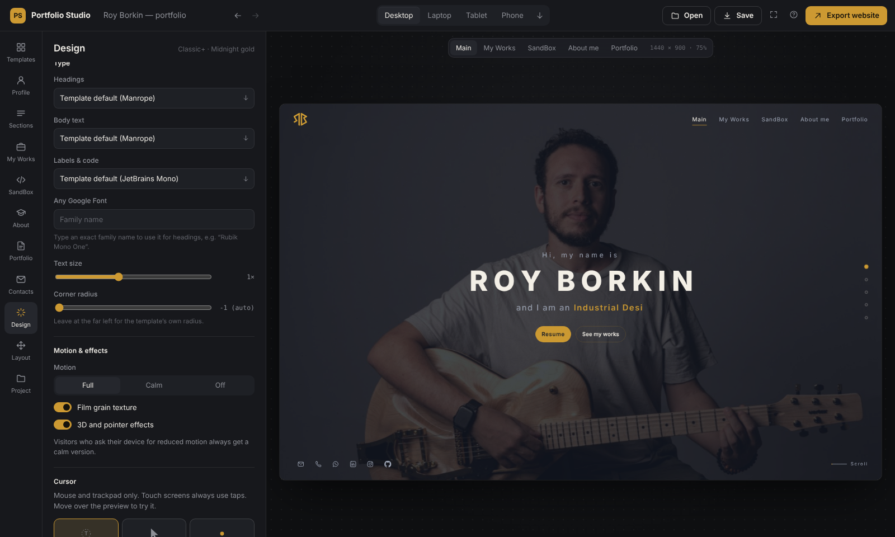
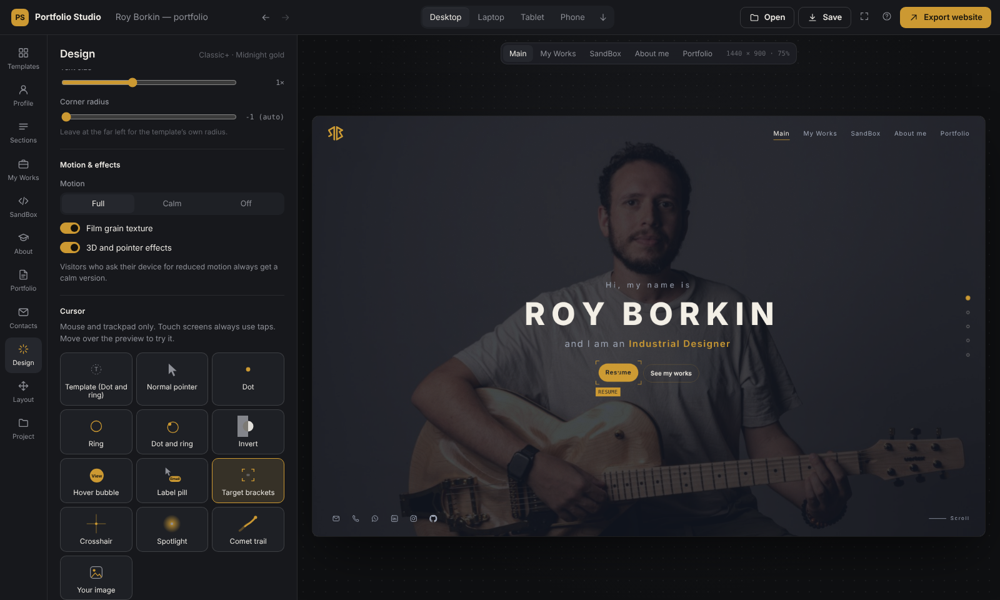
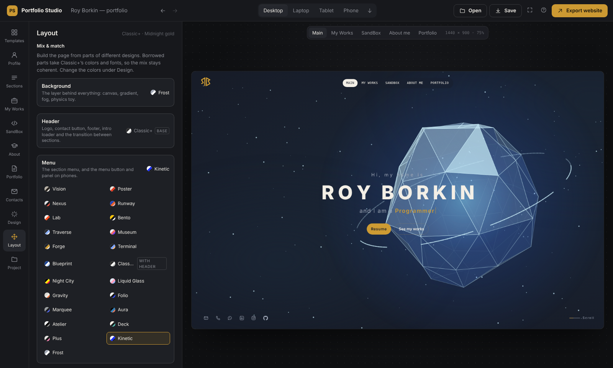
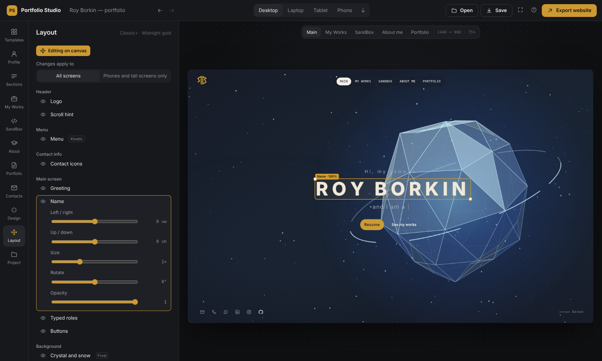
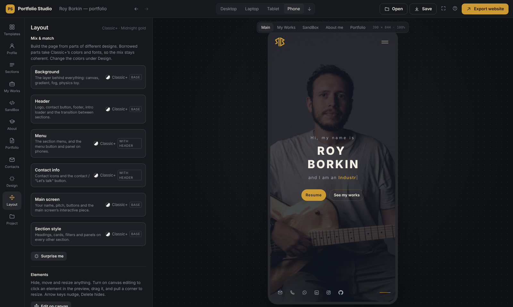
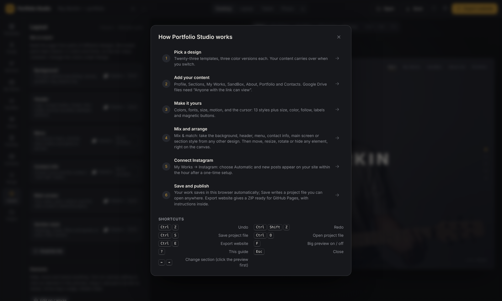

# Portfolio Studio

**Build an animated, one-screen portfolio website without writing code.** Pick from 23 designs, mix their parts,
fill in your work, and export a complete static website that's ready for GitHub Pages. You can also connect
Instagram and LinkedIn so new posts show up on your site by themselves.

**▶ Open the app:** `https://<your-user>.github.io/portfolio-studio/` (after [turning on GitHub Pages](#host-the-app-on-github-pages)),
or double-click `index.html`.



---

## Contents

- [What you get](#what-you-get)
- [The 23 templates](#the-23-templates)
- [Quick start](#quick-start)
- [Guide](#guide)
  - [1. Pick a design](#1-pick-a-design)
  - [2. Add your content](#2-add-your-content)
  - [3. Instagram and LinkedIn](#3-instagram-and-linkedin)
  - [4. Colors, fonts and the cursor](#4-colors-fonts-and-the-cursor)
  - [5. Mix & match parts](#5-mix--match-parts)
  - [6. Move, resize and hide anything](#6-move-resize-and-hide-anything)
  - [7. Check phones and tablets](#7-check-phones-and-tablets)
  - [8. Save, export and publish](#8-save-export-and-publish)
- [Keyboard shortcuts](#keyboard-shortcuts)
- [Host the app on GitHub Pages](#host-the-app-on-github-pages)
- [Run it locally](#run-it-locally)
- [Develop](#develop)
- [FAQ](#faq)

---

## What you get

| | |
|---|---|
| **23 templates × 3 color versions** | Each is a single screen with no scrolling. The sections (Main, My Works, SandBox, About, Portfolio) swap in place with animated transitions. |
| **Mix & match** | Take the background, header, menu, contact info, main screen or section style from any template. |
| **Canvas editing** | Click any element in the preview to move, resize, rotate, fade or hide it. You can keep a separate layout for phones. |
| **13 cursor styles** | Dot, ring, invert, label pill, target brackets, crosshair, spotlight, comet trail, your own image… plus magnetic buttons. |
| **Live preview** | Desktop, laptop, tablet and phone, in portrait and landscape. |
| **Content** | Projects, posts, Instagram and LinkedIn embeds, GitHub repositories (loaded live), a library of small web apps, a résumé, Google Drive portfolios, and every common contact method. |
| **Automatic feeds** | Instagram (official API) and LinkedIn (data export + feed), kept fresh by an hourly GitHub workflow. |
| **Export** | One ZIP: plain HTML, CSS and JS, your images, content as JSON, a GitHub Pages workflow, and a README. |
| **Nothing to install** | The app is a single HTML file. Your work autosaves in the browser and can be saved to a project file. |

## The 23 templates



| # | Template | Style |
|---|---|---|
| 01–08 | Vision · Poster · Nexus · Runway · Lab · Bento · Traverse · Museum | Editorial layouts built around a cut-out portrait |
| 09 | Forge | A 3D logo object on a stage floor |
| 10 | Terminal | Your site as a code editor |
| 11 | Blueprint | Technical drawing with a title block and crosshair |
| 12 | Classic+ | Full-bleed photo with a typed role line |
| 13 | Night City | Cyberpunk: neon, glitch, HUD |
| 14 | Liquid Glass | Frosted panels over moving color |
| 15 | Gravity | Physics keycaps you can grab and throw |
| 16 | Folio | Book spines as navigation |
| 17 | Marquee | Your name running past your photo, magnetic buttons |
| 18 | Aura | A living shader gradient |
| 19 | Atelier | Quiet luxury, "What would you like to see?" navigation |
| 20 | Deck | The site as a pitch deck; visitors can draw |
| 21 | Plus | Museum-signage type, iridescent orb, light/dark switch |
| 22 | Kinetic | A physics cluster you can shove and burst |
| 23 | Frost | An ice crystal you can spin and shatter, with a mono-text HUD |

## Quick start

1. Open the app.
2. **Templates:** click a design and a color version.
3. **Profile → My Works → About → Contacts:** replace the sample content with yours.
4. **Export website:** unzip and upload to a GitHub repository named `<your-user>.github.io`.
   [Publishing guide →](docs/publishing.md)

Press **?** in the app at any time for the built-in guide.

---

## Guide

### 1. Pick a design

**Templates** shows every design as a live thumbnail. Hover the color chips to preview the three versions, and click
to switch. Your content carries over, so you can try as many designs as you like.

### 2. Add your content



| Panel | What goes in it |
|---|---|
| **Profile** | Name, greeting, roles (some templates animate through them), one-line pitch, location, status, time zone, and your photo, cut-out, sketch and logo. |
| **Sections** | Rename, reorder, hide or retitle Main, My Works, SandBox, About and Portfolio. |
| **My Works** | One feed, newest first: projects and site posts (open in a detail view), Instagram and LinkedIn posts (official embeds). Paste many post links at once. |
| **SandBox** | Your GitHub username, so public repositories load live. Also a library of web apps: link one, or upload a single HTML file and it ships with your site. |
| **About** | Bio, photo, stats, experience, education, skills, and a résumé (PDF or Google Drive). |
| **Portfolio** | Links to full portfolios (Google Drive, PDF, Behance…), opened in a viewer. |
| **Contacts** | Email, phone, WhatsApp, LinkedIn, Instagram, GitHub, Telegram, X, website and more. Each can be shown or hidden. |

> **Google Drive files** must be shared as *Anyone with the link → Viewer*, or visitors see a sign-in page.
> The app checks every link and tells you if something won't embed.

### 3. Instagram and LinkedIn


- **Instagram:** paste single post links, or turn on **Automatic**. The exported site then has an hourly GitHub
  workflow that pulls every new post (with its image) through the official Instagram API.
  **[Step-by-step Instagram setup →](docs/instagram.md)**
- **LinkedIn:** LinkedIn doesn't let individuals read their own posts through its API, so there are two ways in:
  - **Import** your posts from LinkedIn's free data export (upload the ZIP).
  - **Automatic:** a feed of your public activity that the same hourly workflow reads.

  **[Step-by-step LinkedIn setup →](docs/linkedin.md)**

### 4. Colors, fonts and the cursor



**Design** sets the colors (or reset to the version's palette), three fonts (any Google Font), text size, corner
radius, motion level (*Full / Calm / Off*), film grain, 3D effects and custom CSS. Visitors whose device asks
for reduced motion always get a calm version.

**Design → Text animation** controls how text appears when a section opens. Pick a style separately for your name,
the section titles and the smaller text (pitch, subtitles): *Template default, No animation, Fade, Rise, Blur in, Zoom,
Words, Letters, Wave, Decode* or *Typewriter*. Set the speed, the delay between letters or words, and whether it plays
every time a section opens or only the first time. **Animate text** switches all of it off, and **Play in the preview**
replays it.



**Design → Cursor** has 13 styles. You can tune its size, color, how far it lags behind the pointer, whether it
grows over links, the label it shows over cards, the click ripple, hiding the normal pointer, how strongly
buttons pull toward it (magnetic buttons), and the reverse: **cursor snap**, where the cursor is pulled onto the
nearest button or link, with a strength and a reach setting. Touch screens always use plain taps.

### 5. Mix & match parts



**Layout → Mix & match** builds the page from six parts. Each can come from any template:

| Part | Contains |
|---|---|
| **Background** | Canvas, gradient, fog, crystal, physics toy… |
| **Header** | Logo, contact button, footer, intro loader and the transition between sections. |
| **Menu** | The section menu, plus the menu button and panel on phones. It follows the header unless you change it. |
| **Contact info** | The contact icons and the contact / "Let's talk" button. It follows the header unless you change it. |
| **Main screen** | Name, pitch, buttons and the main screen's interactive piece. |
| **Section style** | Headings, cards, filters and panels on every other section. |

By default a borrowed part follows your **Design** settings (the base template's colors and fonts, plus your changes),
so the result stays coherent. Every part also has a **Colors & fonts** dropdown listing all 69 looks (every template's
three color versions), so for example a Runway section style can wear Lab's colors and fonts. A main screen or section style whose own look is lighter or darker than your page brings its
own background so it stays readable. **All borrowed parts → Follow Design / Their own look** switches them together.
**Surprise me** rolls a random mix.

### 6. Move, resize and hide anything



**Layout → Elements** lists every element of the current page, grouped as Header, Menu, Contact info, Main screen,
Background and Inside sections. Each one can be shown or hidden, moved, resized, rotated and faded.

Turn on **Edit on canvas** to work directly in the preview:

- **Click** an element to select it.
- **Drag** to move it; drag a **corner** to resize it.
- **Arrow keys** nudge it (Shift for bigger steps); **Delete** hides it.

**Changes apply to → Phones and tall screens only** stores a separate layout for portrait screens.

The same panel also has:

- **Transitions:** 15 styles plus a speed setting.
- **Navigation:** mouse wheel, swipe, keyboard, and looping from the last section to the first.
- **Card size** for every grid, and **items per row** for My Works and SandBox, set separately for desktop,
  laptop / tablet landscape, tablet portrait, phone portrait and phone landscape (or Auto).
- **Section backgrounds:** a color or photo for each section.

### 7. Check phones and tablets



Switch the preview between **Desktop, Laptop, Tablet and Phone**, and rotate it. Every template adapts its layout
to the device and orientation. Press **F** for a big preview without the panels.

### 8. Save, export and publish

- **Autosave:** your work is kept in this browser.
- **Save** (Ctrl S) writes a `*.portfolio.json` project file with every image inside. **Open** (Ctrl O) or drop the
  file on the app to continue on any computer.
- **Export website** (Ctrl E) creates a ZIP:

```
index.html              the site
assets/css, assets/js   engine, template code, your content
assets/img, apps/       your images and uploaded web apps
data/content.json       all your content (editable)
.github/workflows/      GitHub Pages + hourly Instagram / LinkedIn sync (if turned on)
project.portfolio.json  open this in Portfolio Studio to keep editing
README.md               publishing steps
```

**[Publishing guide (GitHub Pages, Netlify, your own domain) →](docs/publishing.md)**

---

## Keyboard shortcuts



| Keys | Action |
|---|---|
| Ctrl Z / Ctrl Shift Z | Undo / redo |
| Ctrl S / Ctrl O | Save / open a project file |
| Ctrl E | Export website |
| F | Big preview on / off |
| ? | Guide |
| Esc | Close |
| ← → (click the preview first) | Change section |

---

## Host the app on GitHub Pages

The repository is ready for GitHub Pages as it is. `index.html` at the top level **is** the finished app, so there is no
build step on GitHub.

1. Create a repository on github.com (for example `portfolio-studio`), set to **Public**.
2. Upload everything from this folder to the `main` branch, including the hidden `.nojekyll` file.
   GitHub Desktop is the easiest way; with the website use **Add file → Upload files**.
3. Go to **Settings → Pages → Build and deployment**:
   - **Source:** *Deploy from a branch*
   - **Branch:** `main`, folder **`/ (root)`** → **Save**
4. Wait about a minute (watch **Actions → pages build and deployment**). The app is live at
   `https://<your-user>.github.io/portfolio-studio/`.

**Check which version you're seeing:** the date and time next to the *Portfolio Studio* logo (top left) is the build
time. It's also shown in the guide (**?**) and at the bottom of **Project**. If an update doesn't show, press
**Ctrl+F5**. GitHub Pages can take a few minutes to refresh.

**Updating the hosted app:** replace `index.html` (and any changed source files), commit and push. Pages republishes
by itself.

> Projects stay in each visitor's own browser; nothing is uploaded anywhere. The app is one self-contained file, so
> you can also open `index.html` straight from your computer.

## Run it locally

- **Without building:** double-click `index.html` in this folder. The app is one self-contained file and works offline
  (except Google Fonts and online embeds).
- **From source:**

```bash
npm install
npm run build        # writes dist/index.html
npm run release      # build, then copy it to ./index.html (the file GitHub Pages serves)
```

Then open `dist/index.html` in Chrome, Edge, Firefox or Safari. You need Node.js 18 or newer.

## Develop

```
index.html                  the finished app (what GitHub Pages serves); regenerate with npm run release
build.mjs                   esbuild: site runtime (engine + one file per template) and the builder (one HTML file)
src/site/engine.js|css      site runtime: sections, paging, embeds, modals, input, cursor, mix & match, feeds
src/site/templates/*.js     one file per template: markup, CSS, effects, 3 color versions
src/site/kit.js             helpers shared by the newer templates
src/builder/*.jsx           the builder UI (React)
src/builder/exporter.js     builds the website ZIP
src/builder/files/          GitHub workflow + Instagram / LinkedIn sync scripts added to exports
src/shared/                 defaults (sample content), editable elements, mix rules, cursor, LinkedIn parsing, icons, fonts
assets/                     sample images
tools/                      Playwright screenshot and test harnesses used during development
docs/                       guides and README screenshots
```

**Add a template:**

1. Create `src/site/templates/<id>.js` exporting `{ id, name, blurb, variants, shell, home, head?, mount?, transition?, css }`.
2. Register it in `src/site/templates/index.js`.
3. List its editable elements in `src/shared/elements.js`.
4. Run `npm run build`.

The test harnesses in `tools/` (`shoot.mjs`, `mixtest.mjs`, `mixsweep.mjs`, `readme-shots.mjs`) use Playwright and
Chromium. Adjust the import path at the top of each to your Playwright install.

## FAQ

**Does it need a server or a database?**
No. Both the app and the exported sites are static files. The optional Instagram and LinkedIn sync runs as a GitHub
workflow.

**Where is my work stored?**
In your browser (IndexedDB), plus any project files you save. Clearing site data removes the browser copy, so save a
project file now and then.

**Can I use my own domain?**
Yes. See [Publishing → custom domain](docs/publishing.md#use-your-own-domain).

**Why does an Instagram or LinkedIn post show a colored tile instead of a picture?**
Neither platform lets other sites pull post images from a pasted link. Upload a cover image for the card, or use the
automatic feeds, which save the images for you.

**Why don't GitHub projects show when I open the exported `index.html` from my disk?**
Browsers block those requests on `file://` pages. They load once the site is online.

## License

Copyright (c) 2026 Roy Borkin. All rights reserved. The source code, templates, designs and documentation may not be
copied, modified or redistributed without written permission; see [LICENSE](LICENSE). Content you put into
your own exported website stays yours, and each exported site shows your name as its copyright holder
(editable under **Project → Website details**).

---

© 2026 Roy Borkin. All rights reserved. See [LICENSE](LICENSE).
