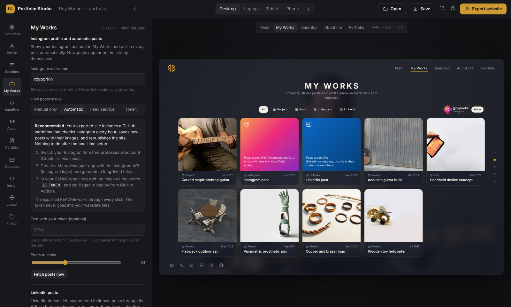

# Instagram posts on your site (automatic)

[← Back to the README](../README.md)

Once this is set up, a new Instagram post appears on your website within about an hour, with nothing to do on your
side. The exported site includes a GitHub workflow that runs every hour and does three things:

1. Reads your posts through the official Instagram API.
2. Saves them, with their images, into `data/instagram.json` and `assets/ig/`.
3. Republishes the site, but only when something changed.

The first setup takes about 30–45 minutes.

## Part 1: Make your Instagram account professional (2 minutes)

The Instagram API only works with **Creator** or **Business** accounts. Switching is free, and your profile looks the
same.

1. In the Instagram app: your profile → **☰** → **Settings and activity**.
2. **Account type and tools** → **Switch to professional account**.
3. Choose **Creator**, pick a category (e.g. "Designer"), and finish.
4. Make sure the account is **public**.

You don't need a Facebook Page.

## Part 2: Create a Meta app and get a token (15 minutes)

1. Go to **developers.facebook.com** and log in. If it's your first time, click **Get Started** and register as a
   developer (it asks you to verify your phone).
2. **My Apps** → **Create App**. Enter a name (e.g. "Portfolio feed") and your email → **Next**.
3. For the use case, choose **Manage messaging & content on Instagram** → **Next** → skip the business portfolio →
   **Create app**.
4. In the app's left menu, open **Instagram** → **API setup with Instagram login**. Don't use the *Facebook login*
   variant.
5. Under **Generate access tokens**, click **Add account** and log in with your Instagram account. Approve the
   permissions.
   - *If it says the account isn't allowed:*
     1. Go to **App roles → Roles → Add People → Instagram Tester** and add your username.
     2. In Instagram, open **Settings → Apps and websites → Tester invites → Accept**.
     3. Repeat this step.
6. Click **Generate token** next to your account and copy the long token. It starts with `IG`.

The token is valid for about 60 days; the workflow renews it (Part 4d). Treat it like a password.

App Review and switching the app to *Live* are **not** needed to read your own posts.

## Part 3: Export the site with Automatic Instagram (3 minutes)

1. In Portfolio Studio: **My Works → Instagram profile and automatic posts**.
2. Enter your **Instagram username**, set **How posts arrive** to **Automatic**, and choose **Posts to show**.
3. Optional: paste the token into **Test with your token** and click **Fetch posts now** to preview your real posts.
   The test token is never saved or exported.
4. **Export website** and unzip it. Check that it contains `.github/workflows/publish.yml`,
   `scripts/instagram-sync.mjs` and `data/instagram.json`. Folders starting with a dot are hidden on Windows; turn on
   **View → Show → Hidden items** in File Explorer.

## Part 4: Set up GitHub (10 minutes)

**a. Upload the files.** Put the unzipped files in your site repository (e.g. `<your-user>.github.io`), including
the hidden `.github` folder. [How →](publishing.md#1-put-the-files-on-github)

**b. Publish through Actions.** Go to **Settings → Pages → Build and deployment → Source** and choose **GitHub Actions**.

**c. Add the token.** Go to **Settings → Secrets and variables → Actions → New repository secret**.
**Name:** `IG_TOKEN`. **Secret:** the token from Part 2.

**d. Let the token renew itself (recommended).**

1. On github.com: your avatar → **Settings → Developer settings → Personal access tokens → Fine-grained tokens →
   Generate new token**.
2. Fill it in:
   - **Repository access:** *Only select repositories* → your site repository.
   - **Permissions → Repository permissions → Secrets:** *Read and write*.
   - **Expiration:** the longest available.
3. Generate it and copy it.
4. Back in the site repository, add it as a secret named `GH_PAT`.

Without `GH_PAT` everything still works, but after about 60 days the run fails and GitHub emails you. Then you
generate a new token (Part 2, step 6) and update `IG_TOKEN`.

## Part 5: First run (2 minutes)

1. Open the repository's **Actions** tab. If asked, click **I understand my workflows, go ahead and enable them**.
2. Click **Publish site** → **Run workflow** → **Run workflow**.
3. When it turns green, open the run → **Sync Instagram**. It lists your posts.
4. Visit your site → **My Works**. Your posts are there, with an **Instagram** filter and a profile card.

From now on the workflow runs every hour. **Run workflow** forces an update at any time.

## Other modes

| Mode | When to use it |
|---|---|
| **Manual only** | Paste individual post links in My Works. |
| **Feed service** | Paste a JSON feed URL from a service such as Behold.so. There's no GitHub setup, and it works with personal accounts. |
| **Token** | The page calls Instagram directly. It's the simplest, but the token is visible in your site's source and expires after 60 days. |

## Troubleshooting

| Message or symptom | Fix |
|---|---|
| `IG_TOKEN secret is missing` | The secret name must be exactly `IG_TOKEN`. |
| `Invalid OAuth access token` (error 190) | The token expired or was copied incompletely. Generate a new one and update the secret. |
| Fails at **Deploy**, or Pages shows nothing | Pages source isn't set to **GitHub Actions** (Part 4b). |
| Fails at **Save new posts** with a permission error | **Settings → Actions → General → Workflow permissions → Read and write permissions.** |
| No **Publish site** workflow | `.github/workflows/publish.yml` wasn't uploaded. Dot-folders are easy to miss. |
| Some posts missing | Raise **Posts to show**, export and upload again. |
| Hourly runs stopped | GitHub pauses schedules in repositories idle for 60 days. The workflow commits once a month to prevent it; if it ever pauses, use **Actions → Publish site → Enable workflow**. |

---

© 2026 Roy Borkin. All rights reserved. See [LICENSE](../LICENSE).
