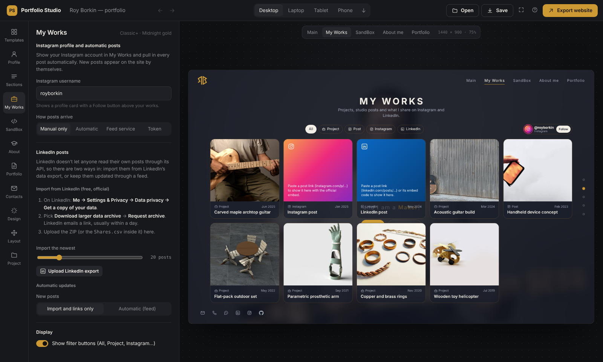

# LinkedIn posts on your site

[← Back to the README](../README.md)

## Why it works differently from Instagram

Instagram has an official API that lets you read your own posts, so the Instagram connection is fully automatic.
**LinkedIn doesn't let individual members read their own posts through its API.** The permission for that
(`r_member_social`) is only given to approved LinkedIn partners. A personal developer app can *publish* posts, but it
can't list them.

So Portfolio Studio offers the two routes that do work, and you can use both together:

| Route | Cost | Automatic? | Best for |
|---|---|---|---|
| **A. Import from LinkedIn's data export** | Free, official | No: import again when you want to catch up | Bringing in your whole history |
| **B. Feed + GitHub workflow** | Free plan of a feed service | Yes, checked every hour | Keeping new posts flowing in |
| *(Always available)* Paste post links | Free | No | One-off posts |

Only **public** posts can be shown. LinkedIn's embed needs them to be public, and posts limited to "Connections only"
are skipped automatically.

---

## Route A: Import from LinkedIn's data export

### 1. Request your data from LinkedIn (2 minutes, then a wait)

1. Sign in at linkedin.com and click **Me** (your photo, top right) → **Settings & Privacy**.
2. In the left menu choose **Data privacy** → **Get a copy of your data**.
3. Select **Download larger data archive, including connections, verifications, contacts, account history, and
   information we infer about you based on your profile and activity.** This is the option that includes your posts.
4. Click **Request archive** and confirm your password.
5. LinkedIn emails you when it's ready, usually within 24 hours (it can take up to 48). The download link stays
   valid for 72 hours.

### 2. Download the archive

Open the email, click the link, and download the ZIP (named like `Basic_LinkedInDataExport_…zip` or `Complete_…zip`).
You don't need to unzip it. Your posts are in the `Shares.csv` file inside.

### 3. Import it into Portfolio Studio

1. Open the app → **My Works** → scroll to **LinkedIn posts**.
2. Set **Import the newest** to how many posts you want (newest first).
3. Click **Upload LinkedIn export** and choose the ZIP. You can also upload just `Shares.csv`.
4. You'll see something like: *Added 18 LinkedIn posts, skipped 3 connections-only.*

The posts now appear in **My Works** (top of the list), and you can edit or delete each one:

- **Title:** taken from the first sentence of the post.
- **Date:** the post's date.
- **Cover image (optional):** upload one for a picture card. Without one, the card shows a LinkedIn-colored tile with the
  post's text.

Clicking a card on your site opens the official LinkedIn embed.

**Updating later:** request a new archive and upload it again. Posts you already have are skipped, so there are never
duplicates. **Remove N imported** removes everything that came from imports.

---

## Route B: Automatic updates through a feed

Here a feed service turns your LinkedIn activity into an RSS feed. The GitHub workflow that ships with your exported
site checks that feed every hour, saves new posts (and their images) into `data/linkedin.json` and `assets/li/`, and
republishes your site.

### 1. Create the feed

You need any service that gives you an **RSS, Atom or JSON feed** of your LinkedIn posts. For example, with
[RSS.app](https://rss.app/rss-feed/linkedin), which has a free plan:

1. Sign up, then choose **New feed → LinkedIn**.
2. Paste your activity page: `https://www.linkedin.com/in/<your-handle>/recent-activity/all/`
   (replace `<your-handle>` with the part after `/in/` in your profile link).
3. Click **Generate**, then copy the feed URL (it looks like `https://rss.app/feeds/xxxxxxxx.xml`; the `.json`
   version works too).

> **Good to know:** LinkedIn actively limits automated access to personal profiles, so support for personal
> activity pages varies between feed services and over time. If a service won't make a feed from your profile:
> - try another feed service;
> - post your work through a **LinkedIn newsletter** or **company page**, which feed services support reliably;
> - or use Route A plus pasted links.
>
> Free plans may also refresh less often than once an hour; the workflow simply picks up whatever the feed has.

### 2. Turn it on in Portfolio Studio

1. **My Works → LinkedIn posts → New posts:** choose **Automatic (feed)**.
2. Paste the feed URL into **Feed URL**.
3. Optional: **Test the feed** loads the posts into the preview. Some services block requests from browsers. If you see
   a message about that, ignore it: GitHub reads the feed directly.
4. Set **Posts to keep** (the workflow keeps that many, newest first, even after they drop out of the feed).
5. **Export website.**

### 3. Publish with GitHub

If you've already set up Instagram's automatic posts, you're done. LinkedIn uses the same workflow, so just upload the
new export. Otherwise:

1. Upload the unzipped site to your GitHub repository, including the hidden `.github` folder
   ([publishing guide](publishing.md#1-put-the-files-on-github)).
2. **Settings → Pages → Build and deployment → Source: GitHub Actions.**
3. **Actions → Publish site → Run workflow.** Open the run and the **Sync LinkedIn** step should say
   *Wrote N LinkedIn posts.*

From then on the workflow runs every hour.

**Changing the feed later** doesn't need a new export. Add the URL as a repository secret named `LI_FEED_URL`
(**Settings → Secrets and variables → Actions → New repository secret**). The secret takes priority over the URL
written in the workflow.

### Troubleshooting

| Message or symptom | Fix |
|---|---|
| `LI_FEED_URL is missing` | Paste the feed URL in the app and export again, or add the `LI_FEED_URL` secret. |
| `The feed answered 403 / 404` | The feed was deleted or is private. Recreate it and update the URL. |
| `Feed has 0 items` | The service hasn't collected your posts yet, or can't read your profile. See *Good to know* above. |
| Posts show a tile instead of a picture | The feed had no image for that post, or the image link had expired. Upload a cover image in My Works. |
| Clicking a post shows "This post cannot be displayed" | The post isn't public. Make it public on LinkedIn, or delete the card. |
| The run fails at "Save new posts" | **Settings → Actions → General → Workflow permissions → Read and write permissions.** |

---

© 2026 Roy Borkin. All rights reserved. See [LICENSE](../LICENSE).
